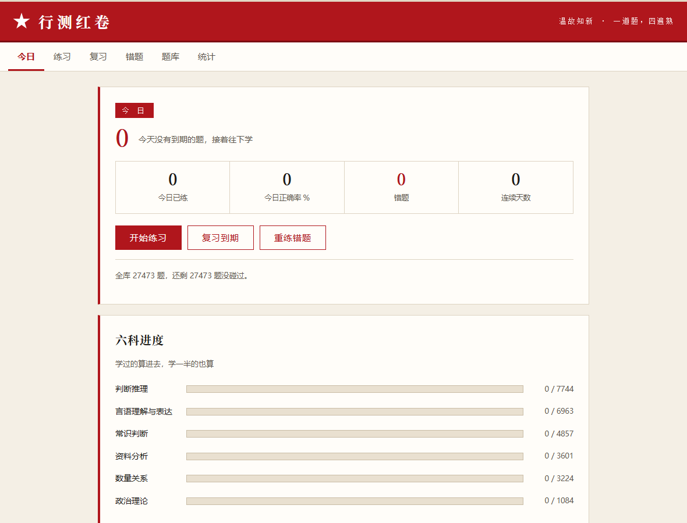
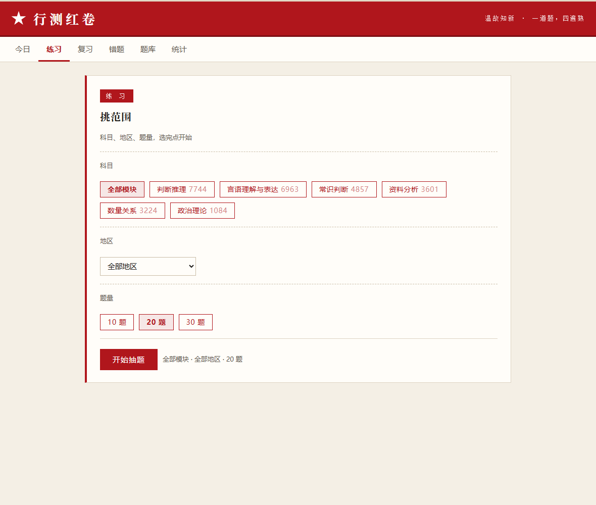
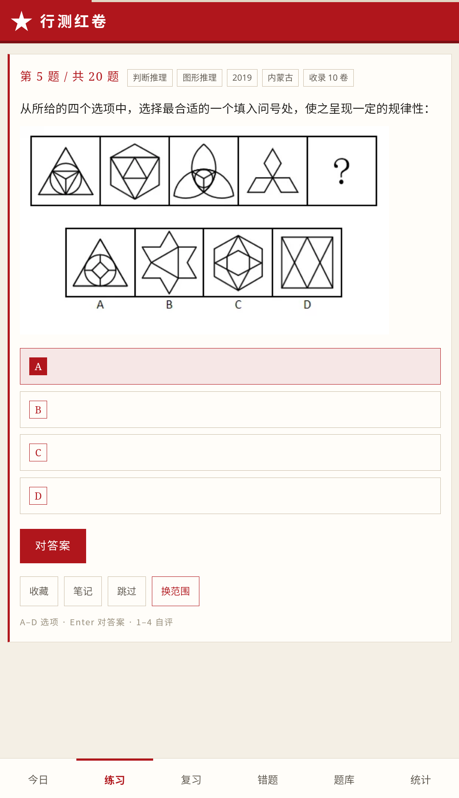

# 行测红卷

行测真题的间隔复习工具。题库与学习进度存于单个 SQLite 文件，离线运行，不依赖网络服务。

- 桌面版：Python 3.8+，仅使用标准库。Windows 提供 `启动.bat`，macOS / Linux 执行 `python server.py`
- 手机版：另需 JDK 17、Android SDK 34、Pillow，构建为离线 APK，题库与配图均打包在应用内

<p>
  
  
  
</p>

## 项目简介

行测题目体量大、遗忘快，市面上的刷题产品多依赖联网、含广告或要求注册账号。
本项目针对这几点做了取舍：题库压缩进单个文件，断网可用；错题按 SM-2 记忆曲线自动回到复习队列；
全部数据为一份 SQLite 文件，备份即文件拷贝，迁移可通过导出的 JSON 完成。
桌面版与 APK 共用同一套前端代码，桌面端主要用于开发调试，可直接刷新查看改动。

数据规模：题源为 [ERRRC/xingcezhenti](https://github.com/ERRRC/xingcezhenti) 的题库副本，
共 515 套卷、58,890 行题目，按 qid 去重后为 **27,473 道**，
覆盖政治理论、常识判断、言语理解与表达、数量关系、判断推理、资料分析六科。

## 题库来源

题库由第三方整理，托管于 [ERRRC/xingcezhenti](https://github.com/ERRRC/xingcezhenti)，
未包含在本仓库中，原因有二：体积较大，版权归整理者。该仓库的目录结构与 `build_db.py` 期望的一致。

获取并导入：

```
git clone https://github.com/ERRRC/xingcezhenti.git ../xingcezhenti
python build_db.py ../xingcezhenti                     # 指定题库目录
set HJ_IMG=../xingcezhenti/90-图片                     # 构建 APK 时指向图片目录
```

`build_db.py` 按以下目录结构读取：

```
01-政治理论/  *.md
02-常识判断/
03-言语理解与表达/
04-数量关系/
05-判断推理/
06-资料分析/
90-图片/      配图目录，可通过 HJ_IMG 指定
```

单篇 Markdown 的格式约定：

- 题目分隔：`### 第 N 题 <sub>qid 123 · 考点</sub>`
- 选项：`- **A**. 内容`
- 答案：`**答案**：A`，其后的内容作为解析

`sample/` 目录下的六篇文件即为符合该格式的示例。

## 快速开始

仓库内含 12 道示例题（六科各两题），无需自备题库即可完整运行：

```
python build_db.py sample --out sample.db     # 从 sample/ 导入示例题
set HJ_DB=sample.db                            # PowerShell: $env:HJ_DB="sample.db"
python server.py
```

使用自有题库时，去掉 `HJ_DB`，默认读取根目录的 `hongjuan.db`。

常规用法：

```
python build_db.py    # 首次运行或题库更新，约 3 秒
python server.py      # 启动服务，默认端口 8400
```

访问 <http://127.0.0.1:8400>。Windows 用户也可双击 `启动.bat`。

`build_db.py` 依赖上述目录结构，目录缺失时不会生成空库，而是报错退出。

## 功能

- **练习**：按科目、地区（34 个）、题量抽取新题。作答后查看解析，再对记忆程度做四档自评。
  中途可通过「换范围」或导航「练习」退出，已作答记录保留。
- **复习**：SM-2 到期题目自动进入队列，未到期题目不参与。
- **错题**：答错题目自动收录，支持单独练习。
- **题库**：按模块、考点、年份、地区、关键词检索，可查看完整解析。
- **统计**：三十天做题量、各科进度、错误率较高的考点。

自评四档对应 SM-2 评分 1/3/4/5：忘了、勉强、一般、熟了。
选择「忘了」时题目次日重新出现，选择「熟了」则复习间隔成倍延长。

键盘操作：`A`–`D` 选择选项，`Enter` 对答案，`1`–`4` 完成自评。

## 服务启动与停止

双击 `启动.bat` 后在控制台窗口内运行服务，窗口生命周期即服务生命周期：

- 窗口保持打开：服务运行中；关闭窗口：服务停止
- 服务进程异常退出时，脚本会在 3 秒后重新拉起，日志输出在同一窗口
- 确认运行状态：`netstat -ano | findstr :8400`，存在 `LISTENING` 即为运行中
- 不设开机自启，系统重启后需重新双击

## 目录说明

```
build_db.py    题库 Markdown → hongjuan.db
server.py      桌面版后端，标准库实现
web/           前端源码，原生 JavaScript，桌面与 APK 共用
android/       安卓工程（WebView + 本地 SQLite）
build_apk.py   APK 构建脚本
tools/smoke.py 真机冒烟测试：安装 → 启动 → 抽题 → 截图 → 统计资源缺失
hongjuan.db    题库与学习进度（约 85MB，由 build_db.py 生成）
```

`hongjuan.db` 包含全部数据。备份文件前请先停止桌面服务（运行时可能有尚未合并的 WAL 文件），也可在页面导出学习进度。
重新运行 `build_db.py` 会在事务中更新题库并保留学习记录；解析失败或未读到题目时不会清空原库。
不要删除数据库后再重建，否则学习进度会丢失。

## 环境变量

与具体机器相关的路径均通过环境变量覆盖，不写入源码：

| 变量 | 作用 | 默认值 |
| --- | --- | --- |
| `HJ_IMG` | 上游图片目录（`90-图片`） | `D:\AI\xingcezhenti\90-图片` |
| `ANDROID_SDK_ROOT` | Android SDK 位置 | `D:\AI\_android_sdk` |
| `HJ_KS_PASS` | 签名密码，也可写入 `android/.kspass`（该文件不入库） | 无，缺失时构建报错 |
| `HJ_ADB` | adb 路径，供冒烟脚本使用 | MuMu 模拟器自带版本 |
| `HJ_DB` | 桌面版读取的数据库 | `./hongjuan.db` |
| `HJ_PORT` | 桌面版端口 | `8400` |

更换机器时调整上述变量即可，无需修改代码。

## 手机版

```
python build_apk.py
```

构建产物为根目录下的 `行测红卷.apk`（约 156MB）。安装后为完全离线版本：
题库与配图打包在应用内，做题记录存储于本机。

首次启动需将题库解压到应用目录，耗时数秒；后续启动加载较快。

**题库随版本更新**：构建时写入 `assets/db/build.txt`，应用启动时与数据库内的版本号比对，
不一致则备份旧库、复制新库，并通过 ATTACH 迁移 `srs` / `reviews` / `favorites` / `notes` 四张表。
覆盖安装不会丢失做题记录。
迁移失败时恢复旧库，成功后保留一份 `.bak` 备份；下次成功更新前会轮换这份备份。

学习记录支持手动导出：今日页底部「进度保险」，导出经由系统分享面板完成，导入在同一位置粘贴 JSON。
导入会覆盖当前四张学习记录表，请先导出备份。只接受本应用导出的 version=1 JSON。

界面固定竖屏，导航位于屏幕底部。

构建依赖 JDK 17、Android SDK（build-tools 34、platform android-34）、Pillow，任一缺失将直接报错退出。
使用 JDK 17 构建；JDK 21 与此版 D8 存在兼容问题。正式包关闭 WebView 调试，仅调试包可开启。

## 自动检查

```text
python -m pip install Pillow
python -m unittest discover -s tests -v
node --check web/app.js
```

测试使用临时示例库，不改动个人题库。GitHub Actions 同步运行这些检查。
桌面服务默认仅监听 `127.0.0.1`，不向局域网开放无认证的进度接口。

与桌面版的关系：两端数据不互通。二者共用 `web/` 下的同一套页面，
APK 端将 `fetch('/api/…')` 替换为 `HJNative.call(…)`，直接访问本地数据库。

## 修改指引

| 修改目标 | 位置 |
| --- | --- |
| 配色、字体、间距 | `web/style.css` 顶部的 `--red` / `--paper` 变量 |
| 首页文案、按钮 | `web/app.js` 的 `viewHome` |
| 抽取规则、间隔算法 | `server.py` 的 `pick()` 与 `schedule()` |
| 题面字段 | `build_db.py` 的 `build_question()` |

图片不做复制，直接读取上游目录。更换题库时将 `HJ_IMG` 指向新的 `90-图片` 目录。

## 发布

Android 依据 `versionCode` 判断版本升级，因此版本号随构建产物递增：

```
python build_apk.py --bump        # 版本号 +1 后构建，versionName 为 1.0.N
python tools/smoke.py --install   # 真机验证
git tag v1.0.N && git push origin main --tags
gh release create v1.0.N 行测红卷.apk --notes-file docs/release-notes.md
```

详细流程见 [`docs/发版.md`](docs/发版.md)，Release 正文模板见 [`docs/release-notes.md`](docs/release-notes.md)。

签名 keystore 丢失后将无法对已安装应用进行覆盖升级，须单独备份。

## 与原项目的差异

移除了多账号注册登录、模拟考试、疑点复核、考点导航、运营面板、Service Worker 与云同步。

保留的核心流程为「抽题 → 判分 → 自评 → 按记忆曲线复习」。
代码量由 1700 + 1600 行降至 420 + 700 行，移除部分可在 git 历史中查阅。

## 已知问题

- 111 道判断题原文无选项，导入时补为「A 正确 / B 错误」。
- 4 道题原文缺答案，不进入练习队列。
- 少数题干残留 Markdown 加粗标记，前端渲染时转换为 `<b>`。
- 图片加载失败时显示虚线「图缺失」占位，用于区分数据缺图与渲染异常；
  失败路径同时记录于 `window.MISSING_IMG` 与 logcat 的 `img-miss`，便于补充素材。
- 39,463 条图片引用中有 2 张上游缺失（`formula-4daf9a3762c10376.png`、`formula-2c7a9ff6774e3af2.png`，
  均位于解析字段），上游仓库的 `图片缺失清单.txt` 亦记录该情况，其余完整。
- 材料题的材料与题干存在少量不对应的情况，源自上游题库的组织方式，不影响作答。

题库版权归原出题方与整理者所有，本项目仅供自用学习。

## 未纳入版本库的内容

| 内容 | 原因 |
| --- | --- |
| `hongjuan.db` | 85MB，可由 `build_db.py` 重建 |
| `android/assets/` | 构建时由题库与图片生成，约 215MB |
| `*.apk` `*.keystore` `*.idsig` | 构建产物与签名材料 |
| `android/.kspass` | 本机签名密码 |
| `memory/` `.share/` | 个人工作记录与临时分发目录 |

克隆后执行 `python build_db.py` 重建题库、`python build_apk.py` 构建安装包即可。
首次构建会自动生成测试用 keystore，正式分发前应替换为自有密钥并妥善备份——
签名变更后只能卸载重装。
